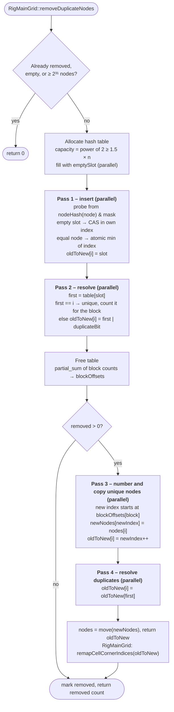
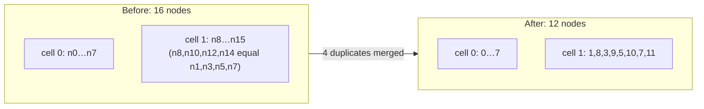

# Removing duplicate grid nodes

`RigMainGrid::removeDuplicateNodes()` merges grid nodes with exactly equal coordinates. Grid readers store eight
separate nodes per cell, even when neighboring cells share corners, so merging them reduces memory use considerably.
The removal runs only when the experimental feature `remove-duplicate-grid-nodes` is enabled
(Preferences → System → Experimental Features).

The algorithm is implemented in `RigGridNodeDeduplication::removeDuplicateNodes()`
(`ApplicationLibCode/ReservoirDataModel/RigGridNodeDeduplication.cpp`). It works on a plain node vector and returns
the mapping from old to new node index. `RigMainGrid` uses the mapping to update the cell corner indices.

**Goal:** merge nodes whose coordinates are exactly equal, keep the first occurrence of each coordinate, keep the kept
nodes in their original order, and point cell corner indices at the new node table. The result is the same as a
simple sequential pass, whatever the thread count.



## Key ideas

| Idea | Why it matters |
|---|---|
| **Fixed blocks of 16,384 nodes** | Each block is numbered from its own offset, so new indices don't depend on how OpenMP schedules the work. |
| **Lock-free insertion** | Slots are claimed with `compare_exchange` through `std::atomic_ref`. A filled slot never changes coordinate; its index can only decrease, through an atomic min. After pass 1 each slot holds the **lowest** index for its coordinate, which is the first occurrence. |
| **`oldToNew` reused for every stage** | It holds the slot (pass 1), then the first index with a duplicate bit (pass 2), then the new index (passes 3–4). No extra per-node arrays are needed. |
| **Duplicate bit (bit 31)** | Separates "first index of my coordinate" from "my new index". This is why the node limit is 2³¹. |
| **Pass 4 has no races** | Duplicates only read entries of unique nodes, and those were finished in pass 3 and are never written in pass 4. |
| **`nodeHash`** | A splitmix64 mix of the exact bit pattern, with −0.0 normalized to 0.0. About 2.4x faster than `std::hash<double>` here. |
| **`isSameNode`** | Compares the same normalized bit patterns as `nodeHash`. It matches `operator==` except for NaN, so NaN nodes with equal bits are merged instead of each probing past all the earlier ones. |

`RigActiveCellGrid` overrides `remapCellCornerIndices()` so the corner indices of its own cell storage are remapped as
well.

## Example: two cells sharing a face



## Cost

Measured with `RigMainGridImportPerformance.DISABLED_SyntheticGridRemoveDuplicateNodes` on a 350 x 350 x 80 synthetic
grid (9.8M cells, 78.4M → 10.0M nodes) with 32 threads:

- **Time:** 0.43–0.52 s, down from 1.82 s for the sequential version.
- **Temporary memory:** about +811 MiB, made up of the 512 MiB hash table and 300 MiB for `oldToNew`. The new node
  table (228 MiB) is allocated after the hash table is freed.
- **Retained memory:** the node table drops from about 1794 MiB to 228 MiB.

Run the performance tests with:

```
ResInsight-tests --gtest_also_run_disabled_tests --gtest_filter=RigMainGridImportPerformance.*
```
